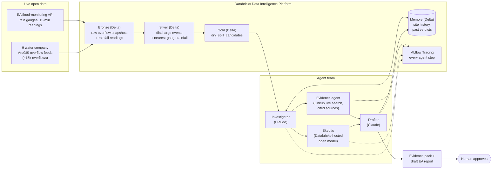

# Sentinels

**Autonomous agents that catch sewage spills on dry days, check their own work, and draft the report to the regulator.**

> About 40 potentially illegal sewage spills happen every day in England, and almost none are caught in real time.

Storm overflows are only allowed to discharge sewage when heavy rain would otherwise flood homes. When an overflow spills on a **dry day**, it may be breaching its permit. In 2025 England had about 291k storm overflow spills (EA). A Times/SAS analysis estimated around 15k dry-day spills a year. Water companies now publish near-real-time overflow status, but nobody joins that data to rainfall as it happens, checks for innocent explanations, and turns a suspicious spill into evidence someone can act on.

Sentinels does this as a pipeline on Databricks plus a team of agents:

1. **Watch.** Pull live overflow status from every water company and rainfall from the Environment Agency.
2. **Flag.** Mark spills that started with no meaningful rain nearby.
3. **Investigate.** An investigator agent builds the case using memory of the site's history and repeat offences.
4. **Challenge.** A skeptic agent, running on a different model, looks for innocent explanations such as a sensor fault, rain the gauges missed, snowmelt or permitted emergency discharge.
5. **Verify.** An evidence agent uses Linkup live web search to find fresh cited context: local news, bathing water closures, past fines, permit details.
6. **Act.** A drafter writes an evidence pack and a draft report to the Environment Agency. A human approves it before anything is sent.

This is not an app. It is a pipeline and an agent system, with every step traced in MLflow.

---

## Architecture



### Why each part exists

| Component | What it does | Why it matters |
|---|---|---|
| **Medallion pipeline** (Bronze → Silver → Gold Delta tables) | Snapshots every overflow's status, turns status changes into discharge events, and joins each event to the nearest rain gauges | Reproducible, auditable data, which an evidence pack needs |
| **Dry-spill rule** | A spill counts as a candidate if every gauge within a set radius saw almost no rain on the day it started and the day before (EA-style dry-day test, thresholds configurable) | Simple, explainable and conservative |
| **Memory** (Delta table) | Keeps each site's past spills, past verdicts and how often the skeptic was right | Lets the investigator spot repeat offenders, and lets the system learn which sites have faulty sensors |
| **Investigator** (Claude) | Builds the case for a breach from the data and the memory | The prosecution |
| **Skeptic** (a different model, served on Databricks) | Argues for innocent explanations and scores how confident we can be | The defence. A second model avoids one model agreeing with itself |
| **Evidence agent** (Linkup) | Searches the live web for fresh, cited context about the site, the river and the company | Turns a data point into something a journalist or regulator can verify |
| **Drafter** (Claude) | Writes the evidence pack and a draft report to the EA, with every claim linked to data or a source | Ends in a real action, approved by a human |
| **MLflow Tracing** | Records every agent call, tool call and decision | Lets us walk judges through one real case step by step |

---

## Data sources

| Source | Access | Licence |
|---|---|---|
| Storm overflow activity: one ArcGIS FeatureServer per company, listed on [Stream Water Data](https://www.streamwaterdata.co.uk/) as part of the National Storm Overflows Hub. Covers Anglian, Northumbrian, Severn Trent, South West, Thames, United Utilities, Wessex, Yorkshire and Scottish Water | Public, no key, max 1000 records per query | CC BY 4.0 |
| [EA flood-monitoring API](https://environment.data.gov.uk/flood-monitoring/doc/reference): rain gauges with 15-minute readings, searchable by location | Public, no key | Open Government Licence |
| [Linkup](https://www.linkup.so/) live web search with cited answers | API key | Commercial API |

Overflow status codes: `1` = discharging, `0` = stopped, `-1` = offline. Each record has the site id, company, current status and when it started, the latest event's start and end, lat/long, the receiving watercourse and a last-updated time. Most companies use the same field names. South West Water uses camelCase and Scottish Water uses a different schema, so ingestion normalises them.

**Known gaps.** Southern Water and Welsh Water publish elsewhere and are not covered yet. The spill data is self-reported by water companies, and rain gauges can miss local showers, which is exactly why the skeptic agent exists.

---

## Repository layout (planned)

```
sentinels/          Python package: feeds, detection, memory, agents, orchestration
notebooks/          Databricks notebooks: 01 ingest (bronze), 02 detect (silver/gold), 03 agents
scripts/            Run the pipeline and one case end to end locally
```

## Models and APIs used

- Anthropic Claude (investigator, drafter)
- An open model served through Databricks Foundation Model APIs (skeptic)
- Linkup Search API (evidence agent)
- Databricks: Delta Lake, Unity Catalog volumes, Jobs, MLflow Tracing
- Water company ArcGIS feeds, EA flood-monitoring API

## Limitations

- A dry-day spill is a **candidate** breach, not proof. Some permits allow discharges in specific dry-weather conditions, and only the EA can decide.
- Rain gauges are sparse, so a nearby unrecorded shower can make a legitimate spill look dry. The skeptic agent and the confidence score exist for this reason.
- No report is sent automatically. A human approves every one.

Built at the Imperial AI Hackathon, 14 to 15 November 2026.
